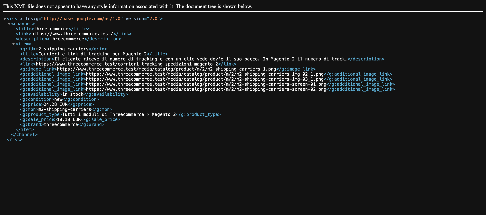
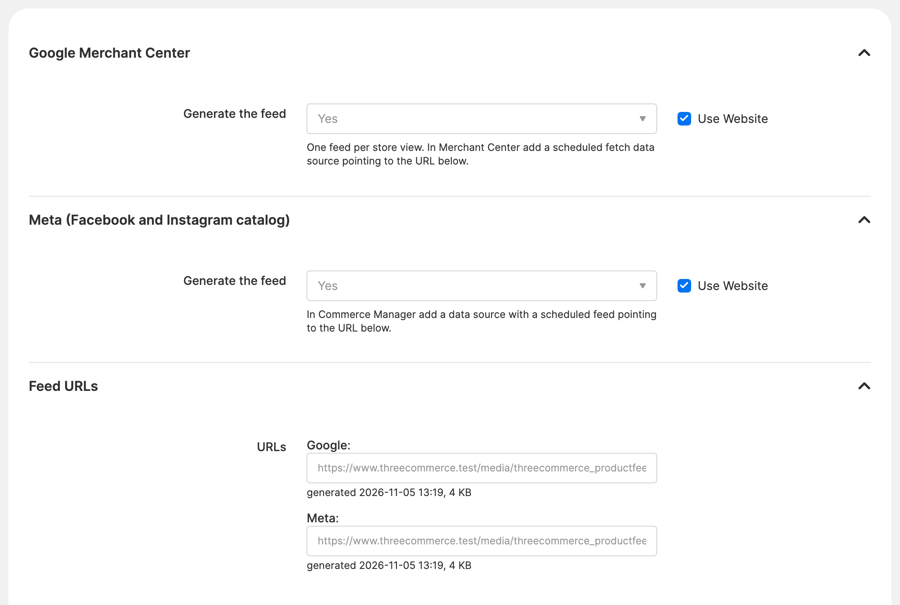

# Threecommerce_ProductFeed: Google Merchant Center and Meta product feed for Magento 2 / Mage-OS

Generates the **product feed** of your catalog for **Google Merchant Center** (Google Shopping) and for the **Meta catalog** (Facebook and Instagram). One XML file per destination and per store view, kept up to date by the Magento cron.

**Compatibility:** Magento Open Source / Adobe Commerce 2.4.4 – 2.4.9 · Mage-OS 1.x / 3.x · PHP 8.1 – 8.4 · any theme (Luma, Hyvä or other: it only works on the catalog)
**License:** commercial · coming soon

## Features

- A **Google Merchant Center feed** and a **Meta catalog feed** for every store view, in the XML (RSS 2.0 with `g:` fields) format both services accept.
- **Protected URL** with a token that cannot be guessed, to paste in Merchant Center or Commerce Manager as a scheduled fetch.
- Refreshed by **cron** (every N hours) or on demand with `bin/magento threecommerce:productfeed:generate`; the file is replaced only when complete, so it is never half written.
- **Price with tax** as in the store, read from the price index: special prices, dates and catalog rules are already applied, with the discounted price in `sale_price`.
- Availability, main and additional images, brand, GTIN, MPN (or SKU), Google product category and the product category path.
- **Filters** by product type, category, attribute (for example "do not advertise") and out-of-stock products.
- Leaves out by itself the items without an image or without a price, which Google and Meta would reject.
- Settings **per store view** in the admin, with the feed URLs and the date of the last generation.

## Requirements

- Magento Open Source / Adobe Commerce 2.4.4+ or Mage-OS
- PHP 8.1 – 8.4
- Package: `threecommerce/m2-base`
- Magento cron running on the server, price index up to date
- A Google Merchant Center account and/or a Meta catalog (Commerce Manager)

## Limitations

Configurable products are exported as a single item at the lowest price: variants (color, size) are not split yet. The module does not push data through the APIs: Google and Meta download the file. Free items (price 0) are left out because Google does not accept them. Shipping, returns and taxes are set in the Merchant Center account, and product approval depends on Google and Meta, which apply specific rules to digital products.

## Availability

This module is **not yet available to buy**. It is a commercial product and is coming soon. To be notified when it is released, or to ask for details, use the [product page](https://www.threecommerce.it/feed-prodotti-google-merchant-meta-magento-2?utm_source=github&utm_medium=readme&utm_campaign=magento2-product-feed) or [get in touch](https://www.threecommerce.it/contatti?utm_source=github&utm_medium=readme&utm_campaign=magento2-product-feed).

## Configuration

*Stores → Configuration → Threecommerce Plugins → Product Feed*, at store view scope: enable Google and/or Meta, then product types, categories, exclusion attribute, brand, GTIN, MPN, description and number of additional images. The feed URLs are shown in the same page.

## Documentation and support

- Product page: [threecommerce.it/feed-prodotti-google-merchant-meta-magento-2](https://www.threecommerce.it/feed-prodotti-google-merchant-meta-magento-2?utm_source=github&utm_medium=readme&utm_campaign=magento2-product-feed)
- [Changelog](CHANGELOG.md)
- Support and custom development: [threecommerce.it/contatti](https://www.threecommerce.it/contatti?utm_source=github&utm_medium=readme&utm_campaign=magento2-product-feed)

---

*This repository is the public showcase of the module. The source code is kept in a private repository.*
